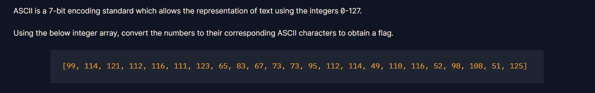
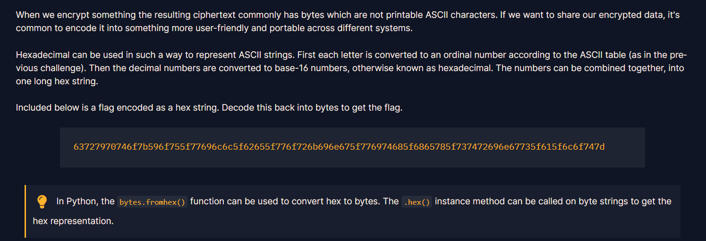
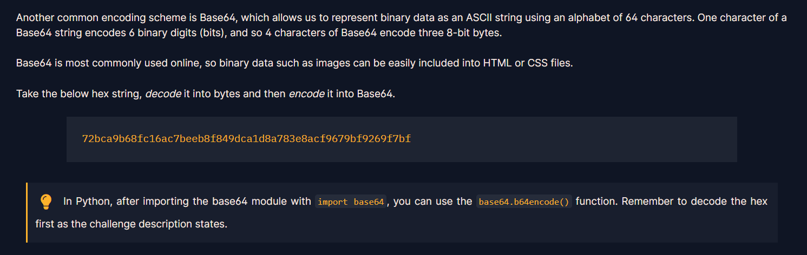
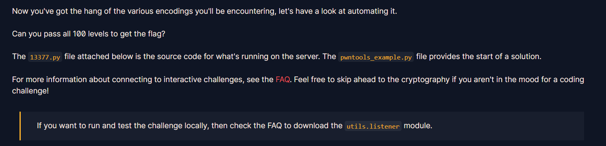

# 1. ASCII

ASCII는 0-127의 정수를 이용하여 표현할 수 있는 7bit 표준 인코딩이다.  
함께 주어지는 배열을 ASCII 문자로 바꾸면 될 것 같다.  
python에서 `chr()` 은 ASCII 숫자를 문자로, `ord()` 함수는 그 반대 역할을 한다.

```python
array = [99, 114, 121, 112, 116, 111, 123, 65, 83, 67, 73, 73, 95, 112, 114, 49, 110, 116, 52, 98, 108, 51, 125]
str = "".join(chr(c) for c in array)
print(str)
```
:spoiler[crypto{ASCII_pr1nt4bl3}]!

---

# 2. Hex

16진수는 ASCII 문자열을 표현하는 데 사용할 수 있다. 각 문자를 ASCII 표에 따라 변환하고, 10진수를 16진수로 변환한다. 아래에 주어지는 문자열은 16진수 문자열로 인코딩된 플래그다. 다시 바이트로 디코딩하면 플래그를 얻을 수 있다고 한다.  
`bytes.fromhex()` 함수는 16진수를 바이트로 변환해 준다. `hex()` 함수는 바이트 문자열을 16진수 표현으로 변환해 준다.  

```python
hexStr = "63727970746f7b596f755f77696c6c5f62655f776f726b696e675f776974685f6865785f737472696e67735f615f6c6f747d"
print(bytes.fromhex(hexStr))
```
:spoiler[crypto{You_will_be_working_with_hex_strings_a_lot}]!

---

# 3. Base64

Base64 도 일반적으로 많이 사용되는 인코딩 방법이다.  
Base64는 64개의 알파벳을 이용하여 ASCII 문자열을 이진 데이터로 표현한다.  
Base64 문자열의 문자 하나는 6bit를 나타낸다. (Base64 문자 4개 당 3바이트의 원본 데이터를 나타낸다.)  
python에서 Base64 인코딩을 사용하려면 `import base64` 로 모듈 import 가 필요하다. `base64.b64encode()` 로 인코딩 전, 먼저 16진수로 디코딩 해주어야 한다.

문제는 주어진 hex string을 bytes로 디코딩 후 Base64로 인코딩 하라고 한다.  
bytes.fromhex()를 이용해 bytes 로 변환 후, base64.b64encode()로 인코딩 해주면 되겠다.

```python
import base64

hexStr = "72bca9b68fc16ac7beeb8f849dca1d8a783e8acf9679bf9269f7bf"
res = base64.b64encode(bytes.fromhex(hexStr))
print(res)
```
:spoiler[crypto/Base+64+Encoding+is+Web+Safe/]!

---

# 4. Bytes and Big Intgers

암호 시스템은 숫자가 기반이지만, 메세지는 문자로 만들어진다. 수학 연산을 적용할 수 있도록 메세지를 숫자로 변환하려면 어떻게 해야할까?  
일반적인 방법은 메세지의 바이트 순서를 가져와 16진수로 변환 후, 16진수/ 10진수로 나타내는 것이다. 

`PyCryptodome` 설치 후 `from Crypto.Util.number import *` 로 모듈을 import 해주어야 관련 메소드를 사용할 수 있다.  
`bytes_to_long()`, `long_to_bytes()` 로 위의 작업을 수행할 수 있다.  

그렇다면, 메세지를 알아내기 위해서는 숫자를 16진수로 바꾸고 ASCII 문자로 바꾸면 되겠다. 
```python
from Crypto.Util.number import *

cipherText = 11515195063862318899931685488813747395775516287289682636499965282714637259206269
byteStr = long_to_bytes(cipherText) # 바이트로 변환 
print(byteStr)
```
:spoiler[crypto{3nc0d1n6_4ll_7h3_w4y_d0wn}]!

:::note
라고 생각했었는데, 주어진 숫자를 long_to_bytes()로 변환하니 플래그가 얻어졌다. 왜 바로 얻어졌지?  

long_to_bytes()는 10진수나 16진수를 (16진수로 변환 후) byte로 변환한다. 
파이썬은 편의상 바이트값이 ASCII 문자(32-126)에 해당하는 범위라면 ASCII 문자에 매칭하여 출력해준다.
:::

---

# 5. Encoding Challenge

갑자기 100단계를 통과하라고 한다. 당황스럽다;;  
문제 코드를 먼저 확인해 보자.
```python
from Crypto.Util.number import bytes_to_long, long_to_bytes
import base64
import codecs
import random

FLAG = "crypto{????????????????????}"
ENCODINGS = [
    "base64",
    "hex",
    "rot13",
    "bigint",
    "utf-8",
]
with open('/usr/share/dict/words') as f:
    WORDS = [line.strip().replace("'", "") for line in f.readlines()]


class Challenge():
    def __init__(self):
        self.no_prompt = True # Immediately send data from the server without waiting for user input
        self.challenge_words = ""
        self.stage = 0

    def create_level(self):
        self.stage += 1
        self.challenge_words = "_".join(random.choices(WORDS, k=3))
        encoding = random.choice(ENCODINGS)

        if encoding == "base64":
            encoded = base64.b64encode(self.challenge_words.encode()).decode()
        elif encoding == "hex":
            encoded = self.challenge_words.encode().hex()
        elif encoding == "rot13":
            encoded = codecs.encode(self.challenge_words, 'rot_13')
        elif encoding == "bigint":
            encoded = hex(bytes_to_long(self.challenge_words.encode()))
        elif encoding == "utf-8":
            encoded = [ord(b) for b in self.challenge_words]

        return {"type": encoding, "encoded": encoded}

    def challenge(self, your_input):
        if self.stage == 0:
            return self.create_level()
        elif self.stage == 100:
            self.exit = True
            return {"flag": FLAG}

        if self.challenge_words == your_input["decoded"]:
            return self.create_level()

        return {"error": "Decoding fail"}
```
`{"type": encoding, "encoded": encoded}` 형식의 객체를 사용자에게 보낸다. 문제의 문자열은 base64, hex, rot13, bigint, utf-8로 인코딩된다.  
stage == 100이 된다면 flag를 뱉는다. 100번째(stage=99) 문제까지 풀고 나서 flag를 얻을 수 있다. 서버에 보내는 형식은 `{"decoded" : 디코딩된문자열}` 이 되어야 한다.  
`.encode()` 를 이용해서 str을 bytes 형식으로 변환 가능하다. 기본값은 utf-8이다. bytes를 str로 변환하는 건 `decode()` 이다.  
`str()` 을 사용해서 바이트를 문자열로 바꿔줄 수도 있다. 

받는 인코딩된 문자가 str 형식인 것을 주의하면서 코드를 짜야할 것 같다.

bigint type 인코딩은 hex를 str로 변환하여 전송하고 있다.  
따라서 받을 때 16진수 문자열로 int화 해주고, int에 대해 decode() 할 수 없으므로 long_to_bytes()를 이용해 byte로 바꾸어준다. int에 대해 str()을 사용하면 그냥 숫자 문자열이 되어버린다. 

```python
from pwn import *
import json
import base64
import codecs
from Crypto.Util.number import long_to_bytes

r = remote('socket.cryptohack.org', 13377, level = 'debug')

def json_recv():
    line = r.recvline()
    return json.loads(line.decode())

def json_send(hsh):
    request = json.dumps(hsh).encode()
    r.sendline(request)

for i in range (100):
    received = json_recv()

    type = received["type"]
    encoded = received["encoded"]

    print(f"{i + 1}. Received type: {type}")
    print(f"Received encoded value: {encoded}\n")

    if type == "base64":
        decoded = base64.b64decode(encoded).decode()
    elif type == "hex":
        decoded = bytes.fromhex(encoded).decode()
    elif type == "rot13":
        decoded = codecs.decode(encoded, 'rot_13')
    elif type == "bigint":
        decoded = long_to_bytes(int(encoded, 16)).decode()
    elif type == "utf-8":
        decoded = "".join(chr(b) for b in encoded)
        
    to_send = { "decoded": decoded }
    json_send(to_send)

received = json_recv()
print(received["flag"])
```
:spoiler[crypto{3nc0d3_d3c0d3_3nc0d3}]!

---

# 정리
- `base64.b64decode()` : 인자 str로 받음. byte 반환
- `bytes.fromhex()` : 인자를 hex로 받음. byte 반환
- `bytes_to_long()` : 인자를 byte로 받음. int 반환 
- `long_to_byte()` : 인자를 int로 받음. byte 반환 
- `int()` : str을 int로 변환, 인자에 진법을 주면 str을 해당 진법 문자열로 인식 