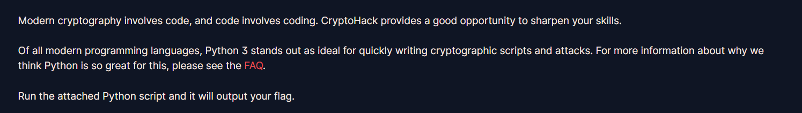
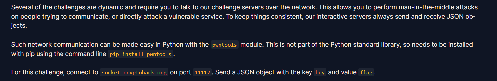

# 1. Finding Flags

플래그 형식을 알려준다. 그냥 입력란에 본문에서 나온 플래그를 입력해주면 된다. 

---

# 2. Great Snakes

python3는 암호화 스크립트와 공격 코드를 작성하기 딱이라고 한다.
그리고 py 파일을 하나 주는데, 그냥 실행하면 된다.

코드는 아래와 같다.
```python
import sys
# import this

if sys.version_info.major == 2:
    print("You are running Python 2, which is no longer supported. Please update to Python 3.")

ords = [81, 64, 75, 66, 70, 93, 73, 72, 1, 92, 109, 2, 84, 109, 66, 75, 70, 90, 2, 92, 79]

print("Here is your flag:")
print("".join(chr(o ^ 0x32) for o in ords))
```

ords 배열에 있는 값들을 o에 하나씩 가져와서 0x32와 XOR연산한다.  
> XOR 연산한 값에 다시 XOR 연산을 할 경우 원래 값으로 돌아온다.

XOR 연산 결과를 `chr()` 을 이용해 문자로 변환한다.  
이렇게 변환된 문자들을 `"".join()` 을 이용해 하나의 문자열로 만든다.

---

# 3. Network Attacks

일부 과제는 pwntools 를 이용하여 통신을 해야하는 듯 하다.  
설치는 `pip install pwntools` 로 가능하다. 

플래그를 얻기 위해서는 HOST와 PORT로 연결해야하고, JSON 객체로 key는 buy, value는 flag를 보내면 이번 문제의 플래그를 얻을 수 있다고 한다.

```python
from pwn import * # pip install pwntools
import json

HOST = "socket.cryptohack.org"
PORT = 11112
r = remote(HOST, PORT) # HOST, PORT로 접속

def json_recv(): 
    line = r.readline() # 라인을 받아서
    return json.loads(line.decode()) # 디코딩 해서 반환 

def json_send(hsh):
    request = json.dumps(hsh).encode() 
    r.sendline(request)

print(r.readline())
print(r.readline())
print(r.readline())
print(r.readline())

request = { "buy": "clothes" }
json_send(request) #요청 전송

response = json_recv()
print(response)
```
`json.dumps(hsh)` 는 python 딕셔너리 타입 객체를 JSON 문자열(객체) 타입으로 가져온다. `.encode` 는 바이트 데이터로 변환한다. 

`json.loads()` 는 JSON 타입 객체를 python 딕셔너리로 가져온다. 

코드에서 "clothes" 부분을 "flag"로 변경해 주면 되겠다.  
:spoiler[crypto{sh0pp1ng_f0r_fl4g5}]