# 논문 정보
- 논문 제목: Power-Related Side-Channel Attacks using the Android Sensor Framework
- 저자: Mathias Oberhuber (Graz University of Technology) 외 4인
- 학회: Network and Distributed System Security (NDSS) Symposium 2025
- [원문 보기](https://www.ndss-symposium.org/ndss-paper/power-related-side-channel-attacks-using-the-android-sensor-framework/)

# 이 논문을 선택한 이유
우선 나는 부채널 공격에 대해 아무것도 모른다. 아무것도는 아니고 HW의 노출되는 전력 등을 이용하여 신호를 해석하는 것 정도로만 알고 있다.  
CTF를 몇 번 깔짝대면서 부채널 공격에 관심이 생겼었다. 어려워 보여서 지금까지 나중에 해야지라는 생각만 하고 건드리지는 않았다. 주어진 페이지를 다 돌아보면서 눈길이 가는 주제들을 40개 정도 리스트업 해두었는데, 대부분이 부채널 공격과 관련된 논문인데다, 마침 Android 유저이기에 흥미가 가서 선택하였다. 이번 기회에 조금 깔짝여보려 한다.

---

# 들어가기 전에... — 개념 정리
## Power Side-Channel Attacks
부채널 공격. 데이터 처리 과정에서 발생하는 기기의 정보 누설을 악용하는 수동적 유형의 공격이다.  
소프트웨어 기반 인터페이스나 물리적 측정 장비를 사용하여 수행될 수 있으며, 공격자가 누설된 부채널 정보를 측정할 수 있다.  
부채널 누설의 source로는 타이밍 동작(timing behavior), 전자기 복사(electromagnetic radiation), 디바이스의 전력 소비(power consumption) 등이 존재한다. 이렇게 획득한 부채널 파형(travce)은 처리되는 비밀 정보와 연관된 정보를 얻기 위해 분석된다. 

### Simple Power Analysis (SPA)
단순 전력 분석. 실행중인 프로세서의 전력 소비를 기반으로 실행된 CPU 연산을 재구성한다.  
암호 연산 수행 시 어떤 명령들이 실행되었는지, 어떤 데이터가 어떻게 바뀌었는지에 따라 전력 소모가 달라진다는 가정을 이용하여, 내부 계산 시퀀스를 만들어보고 실제 측정된 전력 신호와 비교해보는 식이다.

### Differential Power Analysis (DPA)
차분 전력 분석. 기기가 고정된 비밀 정보를 사용해 서로 다른 데이터를 연산할 때 발생하는 전력 파형의 차이를 분석하여 비밀 정보를 알아낸다. 

### Correlation Power Analysis (CPA)
상관 전력 분석. 상관 관꼐 기반 접근 방식으로 암호학적 비밀을 알아낸다. (DPA 특수사례)

## Android Sensor Framework
움직임, 방향, 환경에 대한 데이터 제공. 센서들은 앱에서 사용할 수 있다. 센서는 HW 기반과 SW 기반 센서로 나뉜다.  
- HW 기반: 전용 물리적 하드웨어로부터 데이터를 직접 수집하여 환경 정보를 측정한다. 신호가 물리적 현상을 그대로 반영하기에 신호의 특성이 비교적 명확하다. ex)스마트폰 가속도계가 스마트폰이 얼마나 흔들리는지 측정하는 것.
- SW 기반: 하나 이상의 하드웨어 센서를 이용해 얻은 데이터를 바탕으로 소프트웨어적으로 새로운/가상 센서를 만들어내는 방식이다. ex)가속도계와 자이로스코프의 데이터를 이용하여 폰의 방향을 추정하는 프로그램.

권한이 없는 앱도 센서 프레임워크를 통해 통합 센서에 접근할 수 있고, 프레임워크는 센서 데이터를 구성하고 수신하기 위한 인터페이스를 제공한다.  
앱은 callback함수로 센서가 새 데이터를 준비하면 앱이 자동으로 데이터를 받아 처리하거나, polling방식으로 필요할 때마다 요청해서 센서값을 가져오는 방식으로 값을 받을 수 있다.
- 스트리밍(streaming) 센서: 일정 간격으로 값 제공
- 비스트리밍(non-streaming) 센서: 측정된 매개변수에 변화가 발생할 때만 값을 업데이트

또한 시스템은 화면이 꺼져있을 때 센서를 비활성화하지 않는다. 앱은 센서 값을 얻기 위해 포그라운드 상태가 필요하다. 이는 앱이 화면에 보이는 상태이거나, 포그라운드 서비스로 실행되어야 한다. 즉, 정보를 얻으려면 앱이 항상 실행 중이어야 한다.  네이티브 Android 센서 프레임워크에 포함된 센서의 일부는 웹 브라우저의 JavaScript를 통해 접근할 수 있다. 이때 웹 브라우저는 원래의 센서 데이터가 아니라 다듬어진 값을 준다. 즉, 초당 100개의 정확한 값 대신에 초당 20개의(주기적으로 샘플링된) 값을 준다. 

> 본문에서 사용한 누출, 유출, 누설은 모두 leakage를 뜻한다. 며칠 동안 작성했더니 단어 통일이 되지 않았다. 

---

# 연구 배경
Android 모바일 시스템의 직접적인 에너지 인터페이스는 제한되어있지만, Android 센서 프레임워크는 비권한 앱에서 센서 신호를 여전히 노출하고 있다. PLATPUS나 Hertzbleed, Liu등의 공격은 데스크톱 서버 및 CPU에서 전력 인터페이스나 타이밍 변화를 이용한 공격인데, 모바일 기기의 센서 프레임워크가 가지는 전력 관련 사이드 채널 공격에 대해서는 체계적으로 분석되지 않았다. 권한이 없는 앱이나 웹 브라우저에서도 접근 가능한 센서들이 CPU의 전력 소비를 반영하는 프록시로 동작할 수 있음을 보인다. 

:::note
기존 방식은 PLATPUS 공격과 같이 전용 인터페이스로부터 직접적인 전력 신호를 이용하거나, Hertzbleed 공격과 같이 전력 의존적인 타이밍 변화를 이용한다.  

- PLATPUS 공격은 CPU 내부 인터페이스를 사용하여 전력 소비를 측정함으로써 외부 측정 장비에 대한 제한을 제거하였고, 소프트웨어 기반 인터페이스를 사용하여 전통적인 전력 분석 공격이 실용적임을 입증하였다. 하지만, 이 해당 방법은 인터페이스에 대한 접근을 제한하는 것으로 쉽게 완화되었다.

- Hertzbleed 공격과 Liu 공격은 현대 CPU의 동적 전력 관리에서 발생하는 전력 의존적 타이밍 변화를 사용하여 인터페이스 제한을 우회하는 방법을 보여준다.
:::

# 핵심 아이디어
- Geomagnetic Rotation Vector Sensor(지자기 회전 벡터 센서)가 가장 강력한 누출 원인(누설 프리미티브[^1])임을 밝힘
[^1]: primitive. 정보를 누출하게 하는 가장 기본적이고 재현 가능한 누수 매커니즘. 즉, 시스템에서 정보가 노출되도록 만드는 기본 단위의 사이드 채널 신호.
- Remote Pixel-Stealing Attack: 웹 브라우저 환경에서 SVG filter stack을 사용하여 렌더링 시 발생하는 GPU/CPU 전력 변화를 센서값으로 측정. iframe내의 Cross-origin pixel값을 복원하여 Cross-Origin Isolation 정책 우회
- AES CPA Attack: 로컬 환경에서 ARM NEON의 하드웨어 가속 AES구현을 대상으로 Correlation Power Analysis 수행. 암호화 키 바이트의 일부를 복원하는데 성공하여 일반적인 앱 권한만으로도 HW 보안 구현을 침해할 수 있음을 증명

---

# 실험 — 센서 유출 분석 
센서 유출 분석을 통해 부채널 공격 수행을 위한 잠재적 센서 식별을 위해 각 센서의 유출량을 정량화한다. 또한 권한이 없는 애플리케이션도 접근할 수 있는 Android 센서들과 모든 스트리밍 센서들을 이용하면, 동시에 실행중인 다른 시스템 작업에 대해 부채널 유출이 발생할 수 있음을 입증한다. (가속도계나 자력계 같은 기본 센서 등이 권한이 없는 애플리케이션도 접근할 수 있는 Android 센서들에 해당된다.)

기기는 작성 시점에 사용 가능한 최신 Android 버전을 실행. 모든 기기는 어떠한 수정도 하지 않는다. 추가 권한을 요구하지 않는 일반적인 Android 애플리케이션으로 실행한다. CPU 주파수를 고정하지 않고 DVFS[^2]를 활성화된 상태로 유지한다. 
[^2]: Dynamic Voltage and Frequency Scailing. CPU의 전압(V)과 동작속도(f)를 필요에 따라 실시간으로 바꿔주는 기술. 열 및 전력 제한을 준수하기 위해 시스템 전압과 작동 주파수를 동적으로 조절할 수 있다. 실제 모바일 기기나 현대 CPU는 항상 DVFS로 전압과 주파수를 동적으로 조정한다. 
 
## 1. CPU 사용률
- 방식: CPU 사용률 변화를 위해 과도한 CPU 작업 부하(stress-ng 제품군의 벤치마크 활용)와 유휴(idle) 상태를 번갈아가며 수행, 각 단계는 2.5s 동안 지속한다. 
- 측정값: CPU 온도, 공급 전압 및 전류
- 결과: 센서 값이 CPU 사용률과 상관 관계를 보인다. ▶ CPU 사용률 패턴과 일치하는 인식 가능한 추세이다. 특히 지자기 회전 벡터는 낮음에서 높음으로, 높음에서 낮음으로의 빠른 전환을 보여준다. 
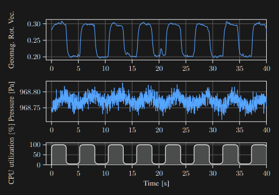
▲ Google Pixel 6a Android 기기에서의 수행 결과. 지자기 회전 벡터는 낮음, 높음 간의 빠른 전환을 보인다. 압력 센서는 시스템 상태에 따라 변화하지만 더 느리게 변화한다. 압력 센서 신호는 더 많은 노이즈를 포함한다.

- 정량화: 높은 CPU 사용률과 낮은 CPU 사용률을 나타내는 ground truth 모델 M = {1, 0}을 설정. 캡처된 센서 값과 M 사이의 Pearson 상관 계수 r을 계산해 선형 관계 강도 정량화한다.
- 결과: Google Pixel 6a의 센서 3개와 전체 센서 26개가 CPU 사용률 변화에 민감한 것으로 나타남(r > 0.7). 지자기 회전 벡터와 같이 자기계 데이터를 포함하는 센서들이 가장 좋은 결를 보여줌. 압력센서, 가속도계, 중력 센서 등 전자기 측정을 포함하지 않는 센서들도 역시 CPU 사용률 부채널 유출에 취약함 
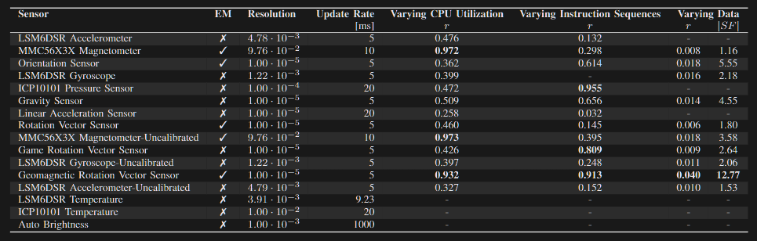
▲ Google Pixel 6a Android 각 센서에 대한 실험 결과 정량화 결과. Varying CPU Utilization 열이 상관 계수이다. 
     
## 2. 명령어 기반 유출 
- 목적: ARM 모바일 CPU에서 실행되는 개별 명령어들이 Android 센서 프레임워크의 센서 판독값에 영향을 미침을 입증. 권한이 없는 센서 판독 값과 내부 공급 전압(휴대폰 배터리 전압)의 상관 관계를 보여, 권한 없는 센서 판독값이 배터리 전압 측정을 위한 프록시 역할을 함을 시사
- 방식: ARM 하드웨어 플랫폼의 선택된 명령어들을 루프 내에서 동시에 실행하며 Android 센서 프레임워크의 각 센서 판독값을 최고 데이터 획득 속도로 수집 
실험에 사용할 명령어는 Oscar Lab의 설문조사를 이용하여 ARM에서 대응 명령어를 선택. str, ror, and, add, mul, fadd, fmul 중 무작위 명령어를 반복적으로 선택하여 각 4초동안 루프에서 실행 
- 측정값: 센서 판독값, 배터리 전압
- 결과: 명령어당 지자기 회전 벡터의 측정값은 세 그룹으로 나뉨. 전압 판독값은 명령어에 대해 유사하지만 반비례하는 분포를 보임
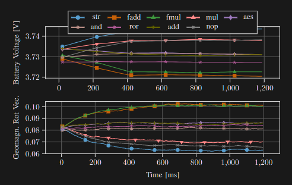
Google Pixel 6a 지자기 회전 벡터 센서의 측정값과 배터리 전압 판독값이다. str, mul, nop은 가장 낮은 값 그룹을 형성, and, ror, add, aes는 중간 값 범위, fadd, fmul은 가장 높은 센서 값을 차지

- 정량화: 센서 측정값과 배터리 전압 사이(선형보간 필요)의 절대 상관 계수 r계산
- 결과: Google Pixle 6a의 센서 중 2개가 배터리 전압과 상관관계가 있는 것으로 나타남. 특히 지자기 회전 벡터와 압력 센서가 배터리 전압과 매우 큰 상관관계를 보임(r > 0.90). 마찬가지로 자기계 데이터를 포함하는지 여부와 관계없이 전압 판독값과 센서 값 사이에 유의미한 상관관계가 관찰됨

▲ 위의 그 표 맞다. Varying Instruction Sequences 열이 상관 계수이다.

## 3. 데이터 의존적 유출 
- 목적: Android 센서 프레임워크로 수집된 센서 판독값이 데이터 의존적 유출[^3]을 보임을 증명 
[^3]: 데이터 의존적 유출: 처리하거나 통신하는 데이터의 값이나 특성에 따라 시스템의 물리적 신호, 실행 시간, 통신 패턴 등이 달라지면서 민감한 정보가 외부로 노출되는 현상
- 방식: 루프 내에서 서로 다른 데이터 피연산자(G와 V)를 처리하는 상수 주기 명령어[^4]를 0.5초 동안 반복적으로 실행. 병렬로 각 센서의 최고 데이터 획득 속도에서 센서 판독값 수집.  
> G와 V는 미리 정의한다. 각 데이터 피연산자에 대해 0에서 7 사이의 난수를 선택하고, 이를 64비트 입력 피연산자의 각 16진수 자리에 인코딩한다(8바이트를 같은 수로 채움 0x11111111). 이 방법으로 유출을 16배 증폭시킴으로써 실험의 추적 수집 과정을 가속화 한다. 
[^4]: 상수 주기 명령어: 모든 실행이 같은 속도로 이루어짐. 데이터가 무엇이든 간에 제어 흐름 변화가 신호에 영향을 주지 않음 
- 측정값: 센서 측정값
- 정량화: 수집된 측정값과 처리된 데이터 피연산자 전력 모델 간의 Pearson 상관 계수 r계산. 전력 모델은 G와 V의 Hamming distance[^6]를 사용. 또한 유의성 계수 $|SF| = \frac{r}{r_{noise}}$ 기록  
> 센서들은 서로 다른 속도로 데이터를 읽기 때문에 각 센서에서 얻은 샘플 수 $N$ 이 다르다. 통계적으로 신뢰할 수 있는 유출 여부를 판단하기 위해 노이즈 수준을 정의, 노이즈 수준과 실제 상관 계수 r을 비교하여 $r > r_{noise}$ 인 경우만 통계적으로 유의미한 것으로 간주한다. $r_{noise} = \frac{4}{\sqrt{N}}$
[^5]: parasitic coupling: 기생 결합. 다른 시스템의 동작으로 인해 센서 프레임워크의 측정값에 간섭이 생기는 현상. 즉, 센서가 측정하려는 것과 무관한 전력 소모의 파생 신호가 센서 읽기에 들어가는 현상 
[^6]: 해밍 거리: 두 입력 간의 서로 다른 비트의 개수. XOR 명령어의 전력 소비를 반영하기 위해 사용

- 결과: 여러 센서가 전력 모델과 통계적으로 유의미한 상관 관계를 보임(parasitic coupling[^5]이 포착). 즉, 센서 값들이 CPU 이용률, 명령어 시퀀스 차이, 데이터 피연산자의 변화 등과 결합되며 전력 관련 신호를 일부 반영함. 자력계 판독값을 포함하는 센서(지자기 회전 벡터, 자력계, 방향 센서...)가 가장 우수한 유출 특성을 보임. 마찬가지로 자력계 판독값을 포함하지 않은 센서도 데이터 의존적 누설을 보이지 않는 것은 아님. 지자기 회전 벡터가 가장 강력한 유출을 보임.

▲ 마지막의 열의 Varying과 |SF| 값
  

# 실험 — 지자기 회전 벡터 특성 분석 
## 1. 방향 의존적 유출
- 방식: 
    1. 테스트 대상 기기를 디스플레이가 위를 향하도록 평평한 표면에 놓음. 
    2. 22.5° 단위로 휴대폰을 회전. 글로벌 기준점은 0° 각도의 자북극으로 설정
    3. CPU는 부하와 유휴 상태를 각 2.5s씩 지속시킴. 나머지 모든 스레드는 최대 데이터 획득 속도로 센서 값 수집
    4. 2, 3단계를 16회동안 반복 (각 방향)
- 결과: 지자기 회전 벡터 센서는 방향 정보를 값의 도메인(x, y, z)으로 기록하기에 시간과 값 도메인에서 정렬해서 비교한다. 트레이스[^7]는 진폭이 다르고(= 각 방향에서의 진폭이 다름), 이는 플롯의 극값 간의 차이로 나타남. 간섭의 방향이 방향에 따라 다름 → 트레이스 진폭의 절댓값에만 의존하며, 더 큰 진폭을 유출하는 방향은 공격에 있어 노이즈와 기타 부작용에 덜 취약하다. 즉, 노리기 딱 좋다!
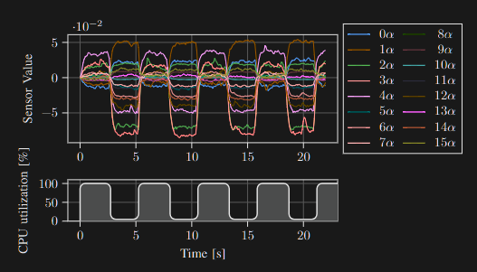
[^7]: trace: 트레이스. 센서가 시간에 따라 남긴 연속된 데이터의 모음. 즉, 어떤 센서가 일정 간격으로 값을 읽고 기록한 연속적인 측정값들의 순서 
- 정량화: 유출 크기 정량화를 위해 부하 단계와 유휴 단계의 센서 값 사이의 평균 거리를 계산
- 결과: 평균 진폭은 0.097~0.002 사이의 범위를 가짐. 이는 두 극단 사이의 50배차이를 의미하는데, 극단적인 경우 CPU 부하로 인해 나침반 앱의 바늘이 30°쯤 편향되는 것과 같음. 

▶ 플롯은 자남극 방향인 180° 부근에서 최대 크기를 보임. 관찰된 진폭은 휴대폰이 양방향으로 회전함에 따라 감소하고, 자북극∙자남극 사이의 평면에 대해 ±90° 각도에서 최솟값에 도달. 
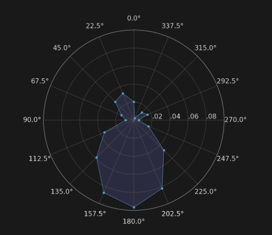

## 2. 통합 동작 분석 
- 목표: ADC(Analog to Digital Converter)는 특정 측정 time window[^8]을 관찰해 아날로그 신호를 샘플링함. 해당 시간 창 동안 아날로그 신호 변화는 통합되어 센서 값으로 보고됨. 이 측정 시간 창과 동시에 실행되는 CPU 작업은 해당 센서 값을 왜곡함 
▶ 센서 시간 창과 동시에 실행되는 워크로드 간 정렬을 최적화 하는 것. 즉, 측정 윈도우 시작점과 CPU 고부하 시작점 사이의 상대 오프셋 $\Delta \theta$ 를 조정하면서 두 신호 간 관계(r)가 최대가 되도록 하는 위치를 찾는 것이 목표 

:::note[워크로드 workloads ?]
: CPU가 수행하는 작업의 부하 상태
- high: 높은 전력 소모 
- low: 낮은 전력 소모 

각 실행은 high와 low 워크로드를 교대로 실행하면서 가장 높은 데이터 획득 속도로 센서 측정을 수집 
:::

[^8]: time window: 시간 창. 센서가 값을 읽는 동안 실제로 데이터를 샘플링하는 시간 구간. ADC(Analog to Digital Converter)가 아날로그 신호를 디지털 값으로 변환하는데 사용되는 측정 시간 창. 센서가 신호를 샘플링하는 구체적이고 가변적인 시간 구간

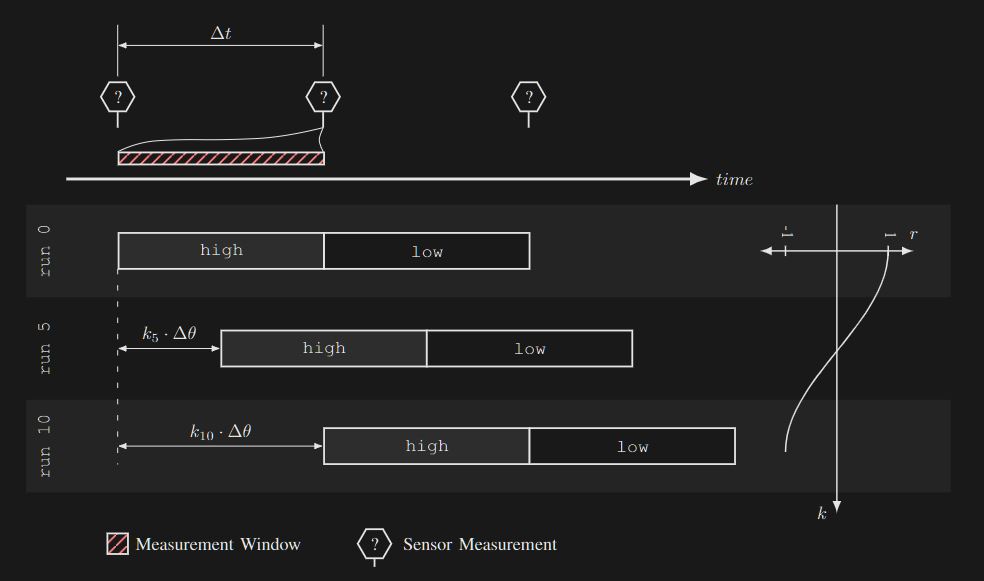
▲ run0은 측정 창과 워크로드의 강한 정렬을 보임 (큰 양의 상관관계), run10은 음의 상관관계를 보임. 각 워크로드는 시간 간격 $\Delta {t}$ 동안 실행됨. $\Delta t$는 두개의 연속적인 센서 측정 사이의 시간과 동일.
- 방식: 각 워크로드의 시작과 센서 측정 사이에 상대 오프셋 $k_{i} \cdot \Delta\theta$도입.  
측정 윈도우 시작 지점과 CPU 고부하 시작점의 상대 오프셋인 $\Delta \theta$를 여러 값으로 바꾸면서 각 $\Delta \theta$에서 두 신호의 상관 관계 r을 계산하며 정렬 지점 탐색.  
워크로드는 XOR 명령어를 연속적으로 실행(G, V 처리). G는 항상 초기값 0으로 고정, V는 0또는 1..1로 고정. 결과는 G에 씀 -> V에 따라 높/낮은 전력 소비 초래. 또한 두 개의 연속적인 센서 값 사이의 정확한 간격 $\Delta t$ 결정함
- 결과: 연속적인 센서 이벤트 사이의 시간 간격이 4.571ms 임을 관찰
- 정량화: 전력 모델과 각 실행의 수집된 측정값 사이 상관 계수 r계산. 높은 전력 소모와 낮은 전력 소모에 대응하는 XOR 연산의 피연산자 V를 전력 모델로 사용.
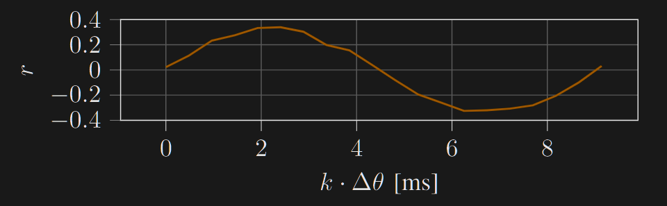
▲ 각 실행 $k_{i}$의 각 상대적 오프셋 $k_i \cdot \Delta\theta$에서 얻은 상관관계를 표시한 것.
- 결과: 2.40ms의 상대적 오프셋에서 최대 상관관계를 보이고, 이는 측정 윈도우와 작업 부하 시작점 사이의 최적 정렬을 나타냄. 따라서 센서 측정 윈도우가 2.17ms 앞서 시작될 것이라 추론. 또한 센서가 작은 시간 창을  샘플링하는 대신 상당한 측정 윈도우에 걸쳐 통합할 것이라 추론. 
▶ 센서가 $\Delta t$의 전체 지속시간 동안 측정하고 통합함

> 지자기 회전 벡터는 회전 의존적이며 통합적인 센서임.

 

# PIXEL-STEALING ATTACK (픽셀 탈취 공격)[^9] — Google Chrome 웹 브라우저를 통한 원격 공격자
[^9]: 픽셀 탈취 공격: 이 맥락에서는, 웹 브라우저에서 렌더링되는 개별 픽셀 색상을 유출할 수 있는 능력 
> cross-origin isolation: 교차 출처 격리

- 공격 시나리오: 피해자가 브라우저를 통해 원격 공격자가 호스팅하거나 제어하는 웹 사이트를 방문하는 원격 공격 시나리오 
공격자의 웹 사이트는 공격자 웹 페이지에 콘텐츠를 직접 표시하는 요소인 iframe 내부에 이미지나 웹 페이지와 같은 교차 출처 콘텐츠를 삽입. (브라우저의 격리 강제 조치로 악성 웹 사이트는 iframe의 콘텐츠 직접 읽을 수 없음.) 
- 공격 흐름:
    1. 교차 출처 콘텐츠가 iframe에 렌더링됨.
    2. 악성 웹페이지의 JavaScript가 브라우저가 제공하는 센서 API에 접근 
    3. 센서 신호의 미세한 변화를 시간에 따라 측정 및 분석
    4. 이 신호로 iframe 안의 비밀 이미지 콘텐츠를 추정하거나 재구성

## 1. 렌더링된 이미지의 프리미티브 유출
- 방식: 256 x 256 크기의 단색 이미지(검/흰)를 구별함으로써 센서 기반 접근 방식의 유출 특성 분석. 두 이미지를 10s씩 교차하여 브라우저에 표시. 이미지 렌더링 전 SVG필터(각 픽셀에 표준편차가 1인 Gaussian blur)를 적용시킴으로써 GPU 집약적인 연산을 수행하도록 함 -> 픽셀의 서로 다른 hamming weight로 인한 GPU 전력 소비 변화 유발.  
캐시된 결과 재사용 방지를 위해 필터 적용 전 무작위 픽셀 노이즈가 포함된 이미지를 추가하여 Gaussian blur 필터의 재계산 강제 
동시에 generic sensor framework로부터 센서 판독값 캡처
- 결과: 유출 프리미티브로 서로 다른 색상 이미지를 렌더링할 때 변화를 보인 자력계와 절대 방향 센서를 식별.  
자력계를 사용한 측정은 두 이미지에 대해 서로 다른 신호 주파수를 유도, 절대 방향 센서는 픽셀 색상에 따라 구성 센서 값 간의 시간 차이를 유도함. 두 센서 모두 generic sensor framework를 사용해 JavaScript에서 접근 가능. 자력계 접근은 브라우저 플래그 일회성 활성화가 필요, 절대 방향 센서는 권한 없이 접근 가능. 
    - 자력계: 
    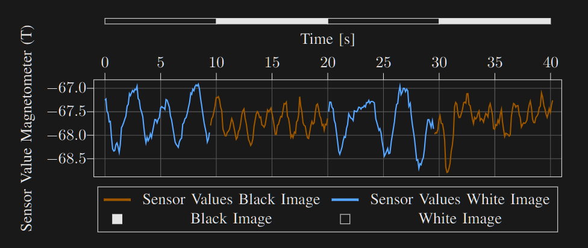 
    40s 동안 검/흰 이미지를 교차 렌더링 하는 과정에서 수집된 센서 값. 흰색 이미지 렌더링 신호가 검정색 이미지 렌더링 신호보다 낮은 주파수에서 진동  
    ▶ 해당 효과가 서로 다른 색상을 처리하는 동안 GPU의 작동 전압 및 주파수 변화에서 기인한다고 가정. 이는 센서 측정이 시스템 배터리 전압과 상관 관계가 있음을 보여주는 분석과 일치하는 결과임. 
    - 절대 방향 센서: 
    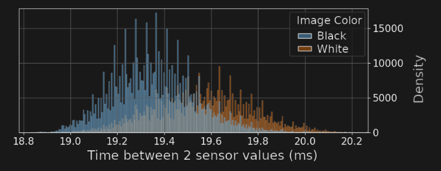
    연속적인 센서 값 사이의 시간 간격에서 변화가 관찰됨. 검/흰 이미지를 모두 렌더링 하는 동안 캡처된 연속적인 센서 값 사이 시간 간격에 대한 히스토그램. 
    검정색 이미지를 렌더링 하는 동안 수집된 연속적인 센서 값 사이의 시간 간격이 평균적으로 흰색 이미지를 렌더링할 때 보다 낮음 -> 렌더링된 이미지의 색상 구별 가능 

    > 자바 스크립트 센서 인터페이스가 센서 값 보고 전, 값을 검사하고 최신 판독값과 크게 다르지 않은 센서 판독값을 폐기하기에, 이미지 색상별 센서 값 사이의 변화로 이어질 것이라 추측

> ▶ 자력계가 센서 신호의 진동 주파수 형태로 유출을 유발, 절대 방향 센서가 연속적인 센서 판독값에 대한 타이밍 차이 유발 

## 2. 엔드 투 엔드 픽셀 탈취 공격 
- 방식: 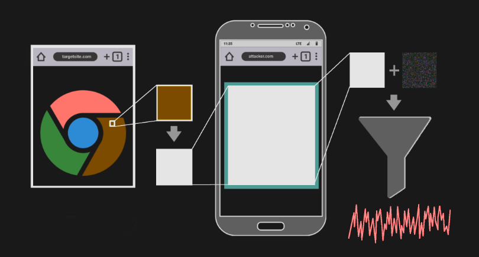
    - 서로 다른 픽셀 색상 구별을 위해 SVG 필터 스택을 이미지 각 픽셀에 개별적으로 적용. 
    1x1의 clip-path영역으로 관심 픽셀 잘라내고, 잘라낸 픽셀만 남기고 나머지 영역은 숨김. 이를 256x256으로 확대하여 해당 픽셀 색상으로 iframe 전체를 채움. 원래 이미지는 흑백으로 변환해 픽셀의 hamming weight 차이를 강화. 이후 SVG 필터 스택을 이미지에 적용. (Google Pixel 6a 대상)

    - 자력계 추적(trace) 개별 픽셀 색상 재구성: 픽셀당 수집된 측정값의 Fast Fourier Transform(FFT) 계산 후 각 픽셀의 신호 주파수 스펙트럼을 표현. 신호는 색상에 따라 다른 주파수로 진동하므로, FFT는 픽셀 변화에 따라 서로 다른 주파수에서 피크를 나타냄. 특정 주파수에서 임계값을 사용해 이미지 픽셀 색상 분류 가능 

- 결과: 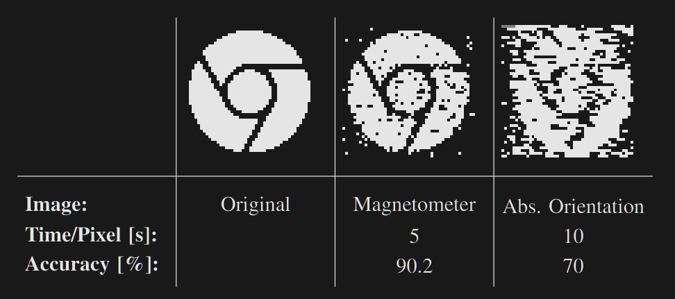
픽셀당 재구성 속도[s]와 정학도[%].  
자력계는 5s/pixel의 가장 빠른 재구성 시간과, 90%의 재구성 정확도를 보임. 절대 방향 센서는 10s/pixel에 70%의 결과를 보임. 절대 방향 센서는 자력계보다 품질은 낮지만, 여전히 콘텐츠 인식 가능 

> ▶ 해당 방법으로 서로 다른 출처의 콘텐츠를 강제 격리하는 교차 출처 격리(cross-origin isolation)을 우회. 초기 유출 분석에서 식별된 스마트폰들이 센서 기반 픽셀 탈취 공격에 취약함

 

# ARM AES 명령어에 대한 CPA 공격 — 설치된 앱 내부에서 실행되는 로컬 공격자
- 공격 시나리오: 사용자가 Google Play Store에서 설치한 앱(Android 앱 샌드박스의 강력한 격리 조치 따름). 앱은 포그라운드 서비스이며 악성 앱이 알려진 평문 블록으로 임의의 AES 암호화를 시작할 수 있는 인터페이스에 액세스할 수 있다고 가정. 로컬 공격자가 기본적으로 허용된 센서 판독값을 악용해 비밀 정보(암호화 키...) 유출 후 하드웨어 가속 AES 구현을 대상으로 CPA(Correlation Power Analysis) 수행. 최종적으로 개별 AES 키 바이트 유출로 순위 감소(rank reduction) 공격 시연

:::note[AES 구현]
- ARM NEON 암호화 확장의 전용 ARM 하드웨어 명령어, 구체적으로 aese와 aesmc 명령어를 사용
- 16바이트 벡터 레지스터에서 작동, aese가 add roundkey, sub bytes, shift rows를, aesmc가 mix columns를 수행
- 각 AES 라운드에 대해 해당 명령어를 인터리빙하면 10개의 라운드를 포함하는 전체 AES-128구현이 됨
- 이 AES 구현은 constant-cycle이고, 입력 데이터와 관계없이 항상 동일한 사이클 수를 요구
:::

- 방식: 
    1. 공격자는 알려진 평문 블록으로 AES 구현을 반복적으로 호출(유출 신호 충분히 확보 위함). 동시에 지자기 회전 벡터 센서 측정값을 4.571ms의 최고 가용 데이터 획득 속도로 수집
    2. 각 센서 이벤트의 프로파일링된 상대 측정 창에 AES 구현 호출을 정확히 정렬
    3. 각 센서 이벤트에 맞춰 새 평문을 선택하고 해당 평문으로 암호화를 반복 트리거(후보에 대해 다른 예측 신호 만들기 위함 -> 상관 관계의 뚜렷함 확보)
    4. CPA를 적용해 키 바이트 후보를 점진적으로 제거(랭크 감소)함
- 결과:
    -  Hamming Distance와 Hamming weight 분석:  
    특정 AES 명령어로 인해 변경되는 내부 암호화 상태의 모든 관찰 가능한 레지스터 값 aessei 및 aesmci 관찰  
    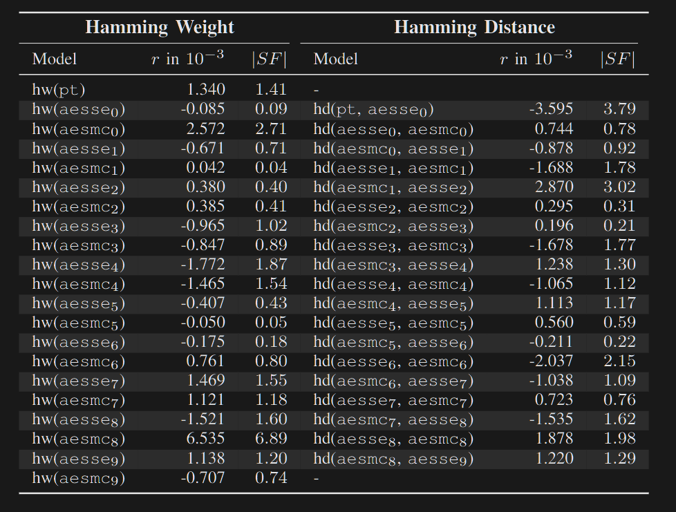
    전반적인 Pearson 상관 계수는 $10^-3$범위로 비교적 작음.  
    8번째 mix columns 출력의 Hamming weight에 대한 상관 관계는 |SF| = 6.89라는 높은 유의성 계수를 보임. 또한 첫 번째 aese 명령의 출력과 들어온 데이터 간의 Hamming distance에 대해 |SF| = 3.79로 비교적 큰 유출이 관찰됨.  
    상관 관계 부호 방향은 대상 라운드에 달라지는 경향을 관찰.

    - CPA 수행:  
    $$M = \text{hw}(\text{sbox}[pn \oplus kn])$$ 을 이용해 CPA 분석 수행. pn은 n번째 평문 바이트, kn은 첫번째 라운드의 n번째 타겟 키 바이트.  
    각 키 바이트 kn에 대해 0-255 범위의 가능한 모든 키 바이트 후보를 열거한 후 Pearson 상관 계수로 M과 측정된 샘플의 상관계수를 분석. 
    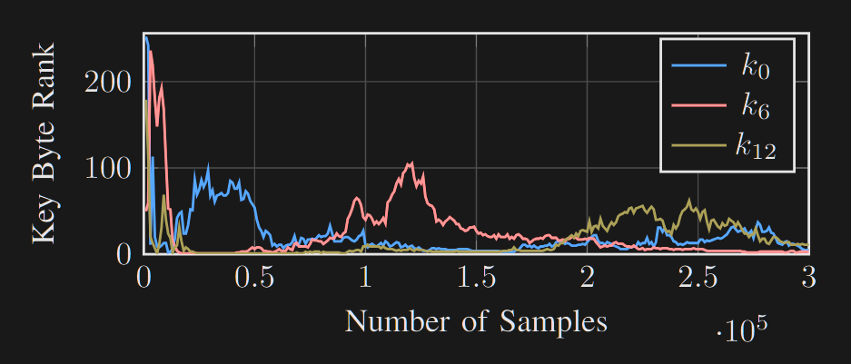
    ▲ CPA 공격에 사용된 샘플 수에 따른 올바른 키 후보의 순위.  
    150,000개의 샘플 이후 0-50 사이의 변동 관찰됨. 전반적으로 CPA가 안정적인 결과로 수렴하는 키 바이트는 0, 6, 12였음. 일부 바이트는 유의미한 추세를 보이지 않음.  
    -> 지자기 회전 벡터 센서가 CPA 공격에 사용 가능한 전력 관련 신호를 노출해도 모든 키 바이트가 안정적인 결과로 수렴하는 것은 아님.

> ▶ 유출이 다소 낮은 상관 관계를 보여도, 공격자는 여전히 키 복잡도를 줄일 수 있음.

# 대응책
해당 연구는 센서 프레임워크가 환경 데이터 수집 도구일 뿐만 아니라, 하드웨어의 미세한 전력 상태를 외부로 노출하는 사이드 채널이 될 수 있음을 밝혔다.  
-  가장 간단하게 완화할 수 있는 방법은 센서 프레임워크에 대한 접근 제한이다. 하지만 많은 앱이 기본적인 기능을 제공하기 위해 판독값을 필요로 하므로, 센서에 대한 접근을 제거하는 것은 사용자 경험에 영향을 미칠 것이다.  
- 특정 센서를 권한 프롬프트 뒤에 숨기는 방법은 공격 표현을 줄여 앱 기능을 유지하면서 공격 탐지를 쉽게 만들 수 있다. 하지만 Android 권한 프롬프트에 대한 이전 연구에 따르면 사용자가 여전히 권한을 부여할 수 있어 공격을 부분적으로만 완화가 가능하다.  
- 데이터의 정밀도를 낮추는 방법 또한 존재한다. Chrome에서 사용되는 아이디어로, 누출을 줄이지만 완전히 차단되지는 않는다. coarse-grained(거친) 정보로도 여전히 공격이 가능하다.
- 하드웨어 수준에서는 암호화 하드웨어 명령과 함께 마스킹과 같은 더 정교한 알고리즘 대책을 구현하는 것이다. 해당 방법은 공격의 난이도를 크게 높인다. 하지만 결국 마스킹이라는 소프트웨어 차원의 방어다. 소프트웨어 차원의 대응책은 Grégoire 등의 방법이 나왔지만, 지연시간을 증가시키기 때문에 많은 서비스들에 널리 적용시키지는 못한다. (사용자 경험에 부정적 영향 미칠 수 있음)
- 센서에 차폐를 추가하거나 센서 회로를 CPU의 전원 공급 도메인으로부터 분리하는 방법도 있다. 전자는 센서 신호가 CPU의 활동으로 인해 왜곡되거나 누출되는 것을 물리적으로 차단할 수 있다. 후자는 CPU가 소비하는 전력의 변화가 센서 전원으로 전달되는 것을 줄여 누출을 줄일 수 있다. 이 또한 원천 차단은 어렵고, 구현 비용과 공간에 제약이 있다.

---

# 느낀 점과 배운점, 앞으로 할 것 
## 느낀 점
나의 첫 논문이 되시겠다. 정말 아무것도 모르는 상태에서 읽은 데다, 영어였기에 내가 제대로 읽고 이해한 것인지도 잘 모르겠다. 용어 하나하나를 찾으며 읽으니 도메인 공부 하나는 잘 될 것 같다는 생각이 들었다.  
논문의 중간중간에 있는 각주들을 보며 보안이라는 분야에서 부채널 공격이라는 더 작은 토픽인데도 불구하고 정말 공부할 수 있는 양이 방대하다는 것을 느꼈다. 

## 논문을 통해 배운 점
## 앞으로 할 것
### 논문
일단 기본적인 다른 개념들을 알아보고 싶어서 논문의 각주에 달려있던 다른 논문들을 읽어보고자 한다. 

### 연구/프로젝트 발전 방향

논문의 문제의식, 핵심 아이디어, 방법론, 평가 결과, 한계, 그리고 앞으로의 확장 가능성까지 포함하여
흐름이 드러나는 리뷰를 작성

논문을 읽기 전에 먼저 아래 내용을 간단히 정리해본다.
이 논문이 다루는 문제는 무엇인가?
왜 이 문제가 중요한가?
기존 방식들은 무엇이 부족했는가?

논문을 읽으며 아래 흐름이 드러나도록 리뷰를 작성한다.
배경 / 문제 정의
핵심 아이디어
방법론 또는 시스템 구성
실험 / 평가 / 결과
한계점 및 아쉬운 점
내가 보기에 앞으로 이어서 해볼 만한 방향
리뷰는 반드시 기승전결이 보이게 작성한다.

기: 이 논문이 등장한 배경과 문제의식
승: 저자들이 제안한 핵심 접근 방식
전: 실험 결과와 실제 성과, 혹은 드러난 한계
결: 내가 느낀 점, 배운 점, 이후 해볼 만한 확장 아이디어
리뷰를 마무리할 때는 반드시 앞으로 할 것까지 적는다.

이 논문을 바탕으로 더 읽어볼 논문
비슷한 문제를 다른 분야에 적용할 가능성
직접 구현, 재현, 비교해보고 싶은 포인트
내가 연구/프로젝트로 발전시킨다면 어떤 방향으로 갈지